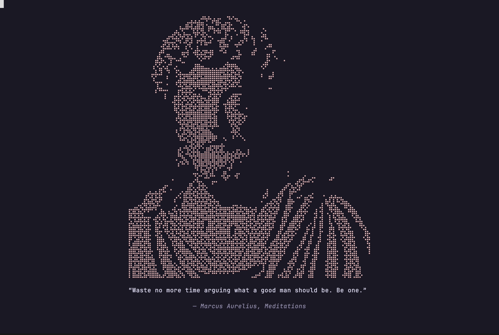
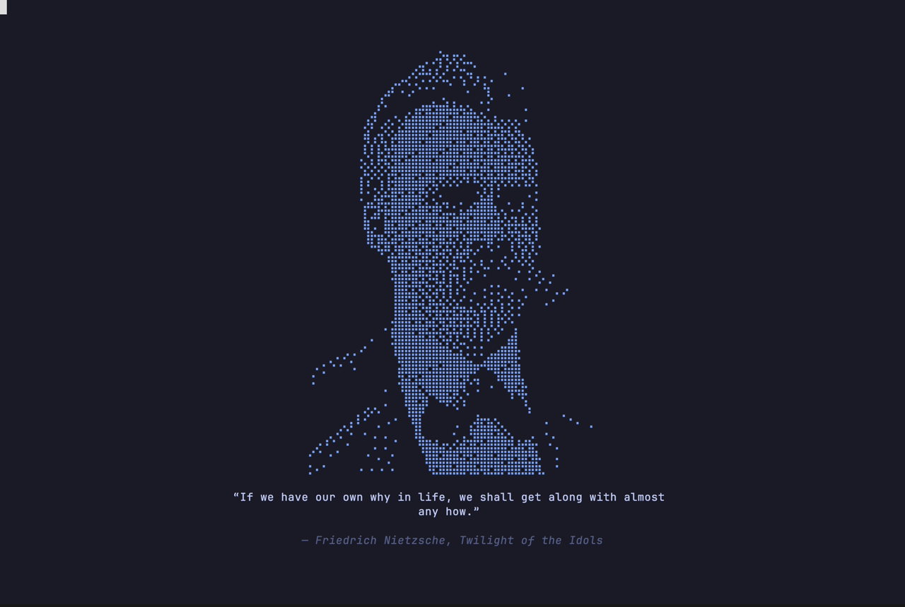
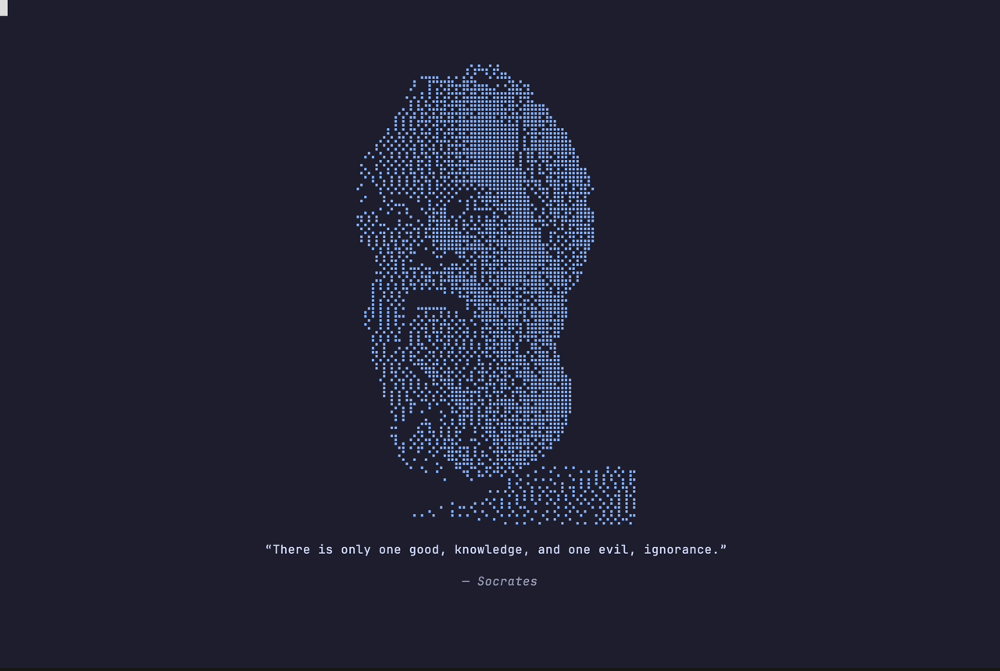
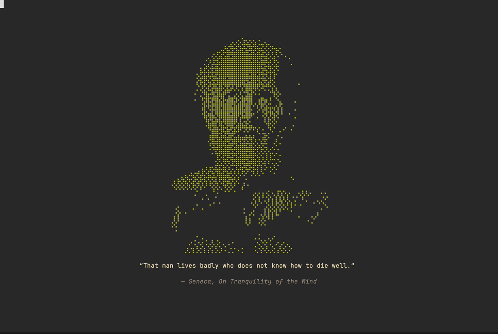
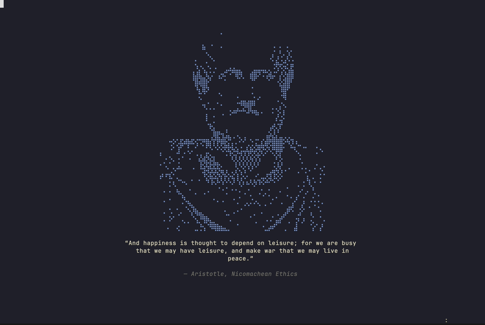
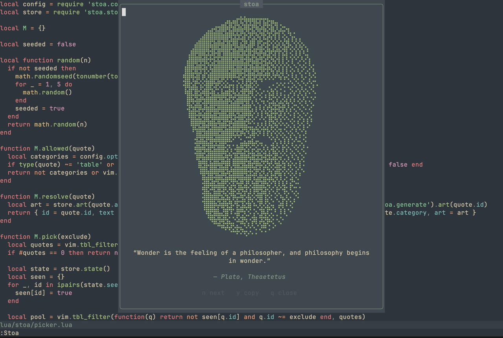

# stoa.nvim

A quote and a portrait, every time you open Neovim.



stoa.nvim replaces the empty start screen with one thought worth reading and a braille portrait of the person who said it. Nothing else is on the screen. Press a key and you are in your files.

- **Works offline.** The quotes and art ship with the plugin.
- **Grows on its own.** A daily job adds quotes to this repo, and the plugin picks them up in the background.
- **Never in your way.** No network call at startup and no error messages, online or offline.
- **No repeats** until you have seen every quote.

| | |
|---|---|
|  |  |
|  |  |

The art takes its color from your colorscheme.

## Install

Requires Neovim 0.10 or newer. `curl` is used for updates only.

**lazy.nvim**

```lua
{
  'devprjl/stoa',
  lazy = false,
  opts = { dashboard = true },
}
```

**vim.pack** (Neovim 0.12)

```lua
vim.pack.add { 'https://github.com/devprjl/stoa' }
require('stoa').setup { dashboard = true }
```

## The splash screen

With `dashboard = true`, opening Neovim without a file shows the splash: art, quote, attribution. The tabline and statusline are hidden while it is up and come back when you leave it.

`n` shows another quote. Add your own shortcuts with `keys`. They work on the splash but are not listed on it:

```lua
require('stoa').setup {
  dashboard = true,
  keys = {
    f = '<cmd>FzfLua files<CR>',
    g = '<cmd>FzfLua live_grep<CR>',
    e = '<cmd>NvimTreeToggle<CR>',
    q = '<cmd>qa<CR>',
  },
}
```

## Commands



| Command | What it does |
|---|---|
| `:Stoa` | Show the current quote and its art in a float (`n` next, `y` copy, `q` close) |
| `:Stoa next` | Pick a new quote and show it |
| `:Stoa home` | Reopen the splash screen |
| `:Stoa notify` | Show the current quote as a notification |
| `:Stoa copy` | Copy the quote and its attribution |
| `:Stoa sync` | Check for new quotes now |
| `:Stoa info` | Pack version, counts, last sync result |

`:Quote` is an alias for `:Stoa`.

## Options

```lua
require('stoa').setup {
  categories = nil,       -- nil for everything, or a list such as { 'philosophy' }
  dashboard = false,      -- show the splash on start
  keys = {},              -- hidden shortcuts on the splash
  quote_command = true,   -- create :Quote
  sync = {
    enabled = true,       -- check GitHub for new quotes in the background
    interval = 86400,     -- seconds between checks
  },
  view = { border = 'rounded', title = ' stoa ', wrap = 64 },
}
```

Highlight groups: `StoaArt`, `StoaQuote`, `StoaAuthor`, `StoaHint`, `StoaBorder`, `StoaTitle`.

## Use it in your own dashboard

`require('stoa').current()` returns the quote for this session, so alpha-nvim, snacks.nvim or dashboard-nvim can show it:

```lua
local stoa = require 'stoa'
local quote = stoa.current()

quote.text            -- 'Waste no more time arguing what a good man should be. Be one.'
quote.author          -- 'Marcus Aurelius'
quote.work            -- 'Meditations'
stoa.art(30)          -- art lines that fit in 30 rows
stoa.attribution()    -- '— Marcus Aurelius, Meditations'
```

## Where the quotes and art come from

- **Quotes** are taken from [Wikiquote](https://en.wikiquote.org) by `scripts/harvest.py`, which keeps short lines that stand on their own and drops duplicates. A GitHub Actions job runs it every day.
- **Art** is a small library, reused across quotes:
  1. a portrait for each well-known person,
  2. art for the category when a person has no portrait yet,
  3. a generated pattern if an art file is missing.
- **Portraits** are made from public-domain images on Wikimedia Commons and converted to braille by `scripts/art.py`. Adding one is a few lines in `scripts/portraits.toml`; see [scripts/BACKFILL.md](scripts/BACKFILL.md).

The pack starts small on purpose: ten philosophers. It grows from there.

## Use the data in your own project

Everything is plain JSON under [`data/`](data), served by GitHub and jsDelivr with no key and no sign-up:

```
https://cdn.jsdelivr.net/gh/devprjl/stoa@main/data/index.json
https://cdn.jsdelivr.net/gh/devprjl/stoa@main/data/quotes.json
https://cdn.jsdelivr.net/gh/devprjl/stoa@main/data/art/<id>.json
```

```sh
curl -s https://cdn.jsdelivr.net/gh/devprjl/stoa@main/data/quotes.json | jq '.[0]'
```

```json
{
  "id": "…",
  "text": "Waste no more time arguing what a good man should be. Be one.",
  "author": "Marcus Aurelius",
  "work": "Meditations",
  "category": "philosophy",
  "art": "marcus-aurelius"
}
```

An art file holds the same picture in two sizes, as lines of braille text:

```json
{ "id": "marcus-aurelius", "name": "Marcus Aurelius", "credit": "…", "large": ["⠀⠀⣀…"], "small": ["⠀⣠…"] }
```

## Credits and license

Code: MIT. Quote text comes from Wikiquote. Portrait sources and their licenses are listed in [CREDITS.md](CREDITS.md).
